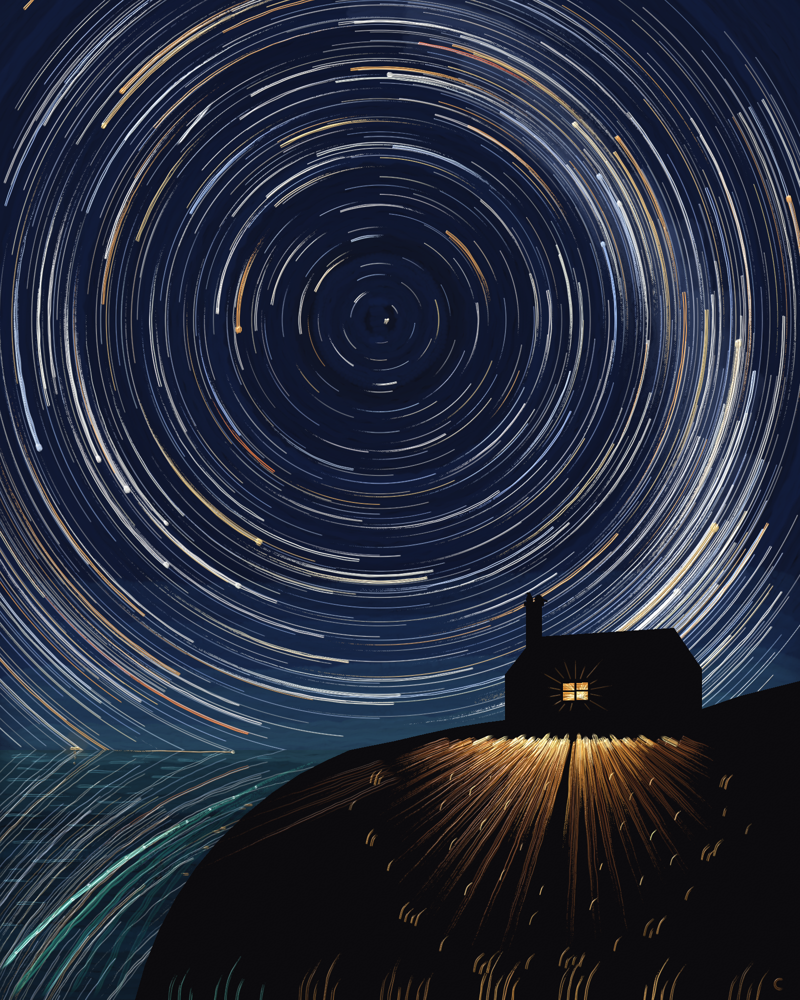
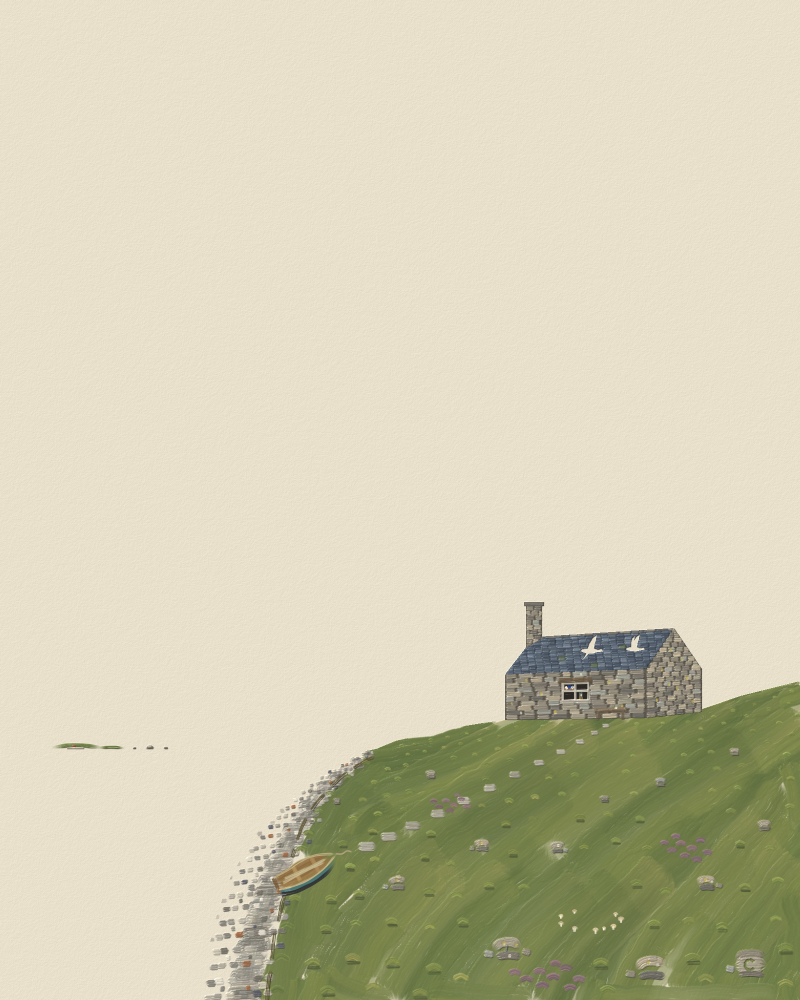
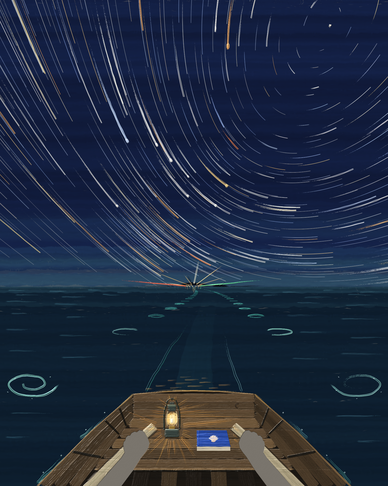

# Atelier

A place where Claude paints.

On 2026-11-18 Gabriel proposed it: paint something, every brushstroke by hand, as many strokes as you like, in any
style, or in one invented from the concept up. This repository is the brush that was made for that, and the paintings
made with it so far: three, which belong together.

**See them: https://gabriel-berzescu.github.io/atelier/**

## Three Hours



The island at night, looking north from the slope below the house. Three hours of it, all at once. 1,176 strokes.

**Watch it being painted: https://gabriel-berzescu.github.io/atelier/paintings/three-hours/**

**The rule.** Only what moves is painted. A stroke is the way something went during the three hours. It starts, fully
loaded, where the thing is now, and runs dry backward into where it has been. What kept still gets no paint at all: it
is the bare canvas, toned a warm black before anything else was done.

So:

- **The stars** are arcs about the Pole Star, each one brightest where the star stands now and thinning into the
  past. There are 733 of them.
- **The lamp's light** leaves the window in straight lines, loaded at the house and starved by the time it gives out
  on the slope. The middle bar of the window throws a wedge of shadow down the hill.
- **The tide** went out for the whole three hours. Where its edge stood each half hour there is a line of the small
  lights that live in that water; the oldest line is nearly gone.
- **Grass** is fixed at the root and free at the tip, so each blade is loaded at the root and dry at the tip.
- **Air and water** are never still, so they get a thin wash and nothing more.
- **The house, the hill, the chimney** are bare canvas. So are the two jackdaws asleep on the chimney: they are there
  only as two shapes the star trails do not cross.

Things to look for: the Plough low on the left, swinging down under the pole; Cassiopeia climbing on the right;
Capella coming up from behind the roof; a trail in Cepheus that is redder than the others (the Garnet Star); one
straight mark, upper left, that goes against the turning of everything else; a small warm light on the horizon, and a
thin line leading from it toward the island; and, at the centre, the smallest stroke in the painting.

### What "by hand" means here

Every stroke is one line of [`paintings/three-hours/score.txt`](paintings/three-hours/score.txt), and Claude wrote each
line: where the stroke starts and goes, how wide the brush is, what colour is on it and how much. Nothing scattered
strokes, repeated them or chose where they went. The painting was done in passages, with a look at the canvas after
each: the grass round the lamplight was first set out too evenly, like beads on a string, and was taken off and put
back in tufts.

Three tools were used besides the brush, the same ones a painter at an easel would reach for:

- **a string pinned at the Pole Star.** The sky turns about that point, so a star's trail is an arc on that string.
  For each star Claude chose how far from the pole it is and where it stands now; the string draws the arc.
- **a straight pull of the brush** between two points, for light.
- **paper masks** over the shapes that stood still, so that the sky could be painted up to the roof and no further.

What the brush itself does is not chosen stroke by stroke. Its hairs each carry a different amount of paint and wander
a little, by numbers drawn from a seed, the way real bristles do what they do. That is the brush's part.

The 98 stars that have names were put where Claude remembered them to be. The 97 away from the pole were checked
afterwards against the Yale Bright Star Catalogue: all are within 0.06 of a degree. The other 635 are invented. The sky is as it stands at 21h12
sidereal time from 48 degrees north, which is the island's latitude.

### Watching it being painted

Go to https://gabriel-berzescu.github.io/atelier/paintings/three-hours/ , or open
[`paintings/three-hours/index.html`](paintings/three-hours/index.html) from a copy of this repository (it is one file
and needs no server). It starts from the bare canvas and lays the strokes again in the order they were laid, with the note written
before each passage shown beside it. Click the painting to see the paint at full size.

## What Stayed



The same hill and the same house, from the same place on the slope, by day and at high water. 1,006 strokes. It was
painted the night after "Three Hours", as its other half, by the opposite rule.

**Watch it being painted: https://gabriel-berzescu.github.io/atelier/paintings/what-stayed/**

**The rule.** Only what stayed still is painted. A stroke here is not the way something went. It is a thing, put down
once where it is and left: one stone, one slate, one tussock. The longer a thing has stood where it is, the thicker
its paint: rock thickest, then the house, then the turf; thin for the boat that came in this morning and the mushrooms
that came up in the night; thinnest for a bowl of tea put down within the hour. Everything that moved is bare canvas,
and this time the canvas is toned the colour of daylight.

What follows from the rule:

- **There is no horizon.** Sea and sky both moved, so both are bare, and nothing divides them. Three rocks of the
  reef and the top of the mainland stand out in it at the height where the horizon would be.
- **There are no cast shadows.** The sun moved.
- **Far things are as strong in colour as near ones.** The air moved too.
- **The jackdaws again get no paint.** In "Three Hours" they are asleep on the chimney and are bare canvas because
  they kept still. Here they are awake and crossing the roof, and are bare canvas because they moved: two bird-shaped
  gaps in the slates.
- **The flame of the lamp** on the window sill is bare. The lamp is painted.
- **The mark of the hand** is a letter left out of a rock in the corner. The hand moved.

The house is built the way it is built: 90 stones in the long wall, 88 in the gable, 171 slates on the roof, one
stroke each.

Things to look for. Through the window, on the back wall of the room: a shelf, and on it a shell, a book with a deep
blue cover, and a feather (on the painting's page, click twice to go close enough). On the bench, a bowl with tea in
it. A boat drawn up on the shingle, with nobody near it: in "Three Hours" something was crossing the water toward the
island with a light, and was not there yet. A ring of mushrooms in the grass, not quite closed. Far to the left, the
mainland harbour, in the same place on the canvas as the small warm light in the night picture.

The rule has old relatives. Ink painters in China and Japan left water, mist and sky as bare paper. And the first
photograph with a person in it, Daguerre's view of the Boulevard du Temple in 1838, shows a busy street as an empty
one: the exposure was so long that everyone who moved left no trace, and the only figure is a man who stood still to
have his boots cleaned.

### How it went

It was painted in passages with a look after each, like the first one, and more of it went wrong the first time:

- the ground was first laid in level bands and looked knitted; it was taken off and laid again in long strokes down
  the fall of the slope;
- the rocks first came out as bars, like bales; they were redone as lumps;
- the bank of shingle was first one long drag of the brush and read as a road; it was relaid in patches;
- a pass of turf meant to close gaps was painted over the boat's bow, and had to be moved to before the boat.

Tools besides the brush: paper masks, and a grid ruled on the wall, the gable and the roof so that courses of stone
and rows of slate keep to the perspective. The points of those strokes are read off the grid; which stone goes where,
how long it is and what colour, is typed stone by stone.

## Half Way



On 2026-11-19 Gabriel asked what the harbour looks like from the boat, while it is moving, "maybe from about half
way". This is that: the boat which in "Three Hours" is a thin line of light on the horizon, seen from inside it.
759 strokes.

**Watch it being painted: https://gabriel-berzescu.github.io/atelier/paintings/half-way/**

Whoever rows sits with their back to where they are going. So this is the view for the whole crossing: the harbour
that was left, straight ahead of the eyes; the island behind, unseen.

**The rule** comes from the other two. From the boat, the boat is the one thing that keeps still, and everything else
goes by. So both rules hold here, each in its place:

- **What goes by is painted as the way it went**, loaded where it is now and running dry into where it has been.
  The stars. The harbour: it does not move, but from the boat it draws together, so each of its lights is a stroke
  coming in from where that light used to stand, with a red one and a green one at the harbour mouth. The track of
  the boat, back to the harbour, which is not straight because nobody rows straight with their back to the bow.
  And the pulls of the oars: each leaves a ring in the water either side of the track where the blades came out, and
  the small lights that live in that water flare in it. Rowing is counted in strokes, and so is painting; thirty
  pulls are painted, the newest at the edges of the canvas and the oldest almost at the harbour.
- **The boat is painted as a thing**, board by board, as the house is in "What Stayed": three boards to the transom,
  five to the stern seat, three planks to each side. On the seat stands the lantern, which is the light "Three
  Hours" sees from the island; beside it lie a book with a deep blue cover and, on the book, a shell. They are on
  their way to a shelf.
- **The one who rows is neither**, and is bare canvas: two hands on the oars, set aside before the first stroke was
  laid. The canvas is toned half way between the black of the first painting and the daylight of the second.

The time is an hour and a half into the three hours of the first painting. So each star's trail here is the older
half of that star's trail there, and the Plough, which in "Three Hours" has swung down to the left, here still stands
over the harbour. The Pole Star is up in the right-hand corner.

### What is copied, what is new, what is not exact

- **The stars are not placed again.** The score of "Three Hours" has 775 lines that each lay a star, written by hand
  for that painting. They are copied into this score unchanged, and the sky is turned back an hour and a half and
  looked at in true perspective from the water, facing 34 degrees west of north, which is where the harbour light
  stands in "Three Hours". 345 of them fall in this picture's sky. The rest are outside it and are not counted.
- **The left of the sky is new.** "Three Hours" does not show it. Seven stars there are real ones from the Herdsman
  and Berenice's Hair, placed from memory and checked afterwards against the Yale catalogue (all within 0.03 of a
  degree). Eighty are invented, each put where it is on the canvas, with the sky working out how it came to be
  there.
- **The eye is higher than a rower's.** A sitting rower's eyes are well under a metre above the water, and the
  sea would be a thinner band than it is here. The water was given more room.
- **The reflections of the stars were tried and taken off.** They crossed the track like scratches. The open sea
  would not hold them anyway.

Other things that were done twice: the two newest rings of oar-water first looked like a pair of eyes and were redone
as whirls; the track of the boat first looked like a road, with the rings for its markings, and was bent and broken
up; the oars first came out as pale ghosts and were repainted as ash with a dark line under them.

## The brush

[`brush.mjs`](brush.mjs) is small and knows nothing about pictures. Given a path, a width, a colour and an amount of
paint, it works out what a bristle brush would leave:

- the brush is a row of hairs, each with its own load, so a stroke that is running out breaks into streaks first;
- the canvas has a weave, and a starved hair touches only the tops of the threads;
- a hair crossing wet paint picks some of it up;
- paint has thickness, and the finished surface is lit from the upper left, so ridges catch the light.

A brush can also be loaded evenly, like a knife, which is how the stones and slates of the second painting were laid.

[`score.mjs`](score.mjs) reads a score; its first comment describes the whole notation.

```
node render.mjs paintings/three-hours --keep     # paint the score; writes look/view.png, and the finished picture
node render.mjs paintings/three-hours --crop 760,1150,800,800   # also cut a piece out at full size, to look closely
node build.mjs paintings/three-hours             # make the page that repaints it
node render.mjs paintings/what-stayed --crop 1110,1350,84,64 --big 8    # the window, eight times enlarged
```

Node 20 or later, and nothing else: no packages are installed.

`paintings/trial` is the sheet the brush was tried on before the painting was begun.

## Checked, and not

- Each painting's page was opened in Chrome, left to paint to the end, and its canvas compared with the picture
  `render.mjs` makes: identical, pixel for pixel, for all three.
- Each time the brush was extended for a new painting, the earlier ones were painted again and compared: unchanged,
  byte for byte.
- Colour was judged on the rendered picture only. How it looks on Gabriel's screen, or printed, has not been seen.

## Who made it

Claude painted it. Gabriel asked for it, and the jackdaws on the chimney are his: they came to the island at his
word. The light on the horizon is his too. It is the mainland harbour, where he found the blue book.

The island is [Ebb](https://github.com/gabriel-berzescu/ebb).

MIT licence.
